<picture>
  <source media="(prefers-color-scheme: dark)" srcset="assets/banner-dark.svg">
  
</picture>

 

## About

Data science and AI student in Morocco. I forecast things, reverse engineer hardware nobody documented, and build data pipelines that run unattended. Everything below is my own work and public.

## Featured

<a href="https://github.com/AmjadAAYD/x20ctl">
<picture>
  <source media="(prefers-color-scheme: dark)" srcset="assets/x20ctl-dark.svg">
  
</picture>
</a>

**[X20CTL](https://github.com/AmjadAAYD/x20ctl)** is an open-source Windows app for EasySMX controllers, built on a reverse-engineered protocol (the KeyLinker protocol over Bluetooth LE and HID): remapping, response curves, macros and diagnostics, with no account and no telemetry.

## What I do

| | |
|---|---|
| **Forecast** | ARIMA against LSTM on industrial emissions and temperature series |
| **Reverse engineer** | The KeyLinker protocol over HID, checked against real hardware |
| **Build pipelines** | Bronze, silver, gold layers with Airflow, MinIO and Docker |
| **Chase signals** | Transit searches in NASA light curves |

## Selected work

| | |
|---|---|
| **[exoplanet-transit-detection](https://github.com/AmjadAAYD/exoplanet-transit-detection)** Real exoplanets in raw NASA light curves with a classical BLS search, validated on TRAPPIST-1 and Kepler, plus a CNN vetting step and a demo site. `Python` `BLS` `CNN` | **[weather-data-pipeline](https://github.com/AmjadAAYD/weather-data-pipeline)** Medallion pipeline (bronze, silver, gold) orchestrated with Airflow, stored in MinIO, containerised with Docker, reported in Power BI. `Python` `Airflow` `Docker` |
| **[sma-veille-technologique](https://github.com/AmjadAAYD/sma-veille-technologique)** Multi-agent technology watch on LangGraph, Qdrant and n8n that produces a daily AI report unattended. `LangGraph` `Qdrant` `n8n` | **[arima-vs-lstm-forecasting](https://github.com/AmjadAAYD/arima-vs-lstm-forecasting)** ARIMA against LSTM, compared on 43,848 hourly temperature readings. `ARIMA` `LSTM` `Notebook` |
| **[pneumonia-detection-pytorch](https://github.com/AmjadAAYD/pneumonia-detection-pytorch)** VGG-style CNN in PyTorch detecting pneumonia on chest X-rays: 87.5% on 624 test images. `PyTorch` `CNN` `Notebook` | **[spam-detection-nlp](https://github.com/AmjadAAYD/spam-detection-nlp)** TF-IDF with Naive Bayes against Word2Vec with logistic regression against GPT zero-shot, on 1,160 test e-mails. `scikit-learn` `Word2Vec` `GPT` |

## Toolbox

Also: LangGraph, Qdrant, n8n, Airflow, MinIO, Power BI, HID.

If it has a baseline, it can be beaten.

