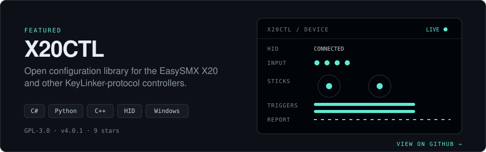
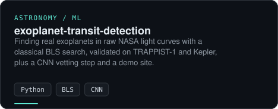
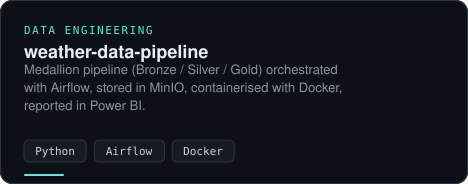
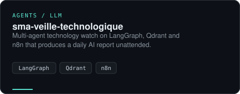
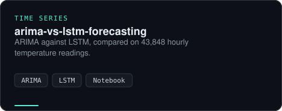
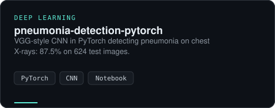
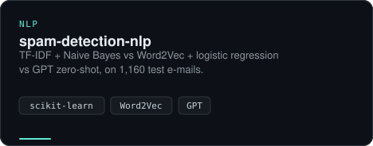

 

  <a href="https://github.com/AmjadAAYD/x20ctl"><b>Source</b></a> &nbsp;·&nbsp;
  <a href="https://github.com/AmjadAAYD/x20ctl/releases"><b>Releases</b></a>

### Selected work

<table>
<tr><td width="50%"></td><td width="50%"></td></tr>
<tr><td width="50%"></td><td width="50%"></td></tr>
<tr><td width="50%"></td><td width="50%"></td></tr>
</table>

### About

Data Science &amp; AI student in Morocco. Two internships forecasting industrial emissions.
I publish every metric with the baseline it had to beat.

**Stack:** Python · PyTorch · scikit-learn · LangGraph · Airflow · Docker · C# · C++
