 

  <a href="https://github.com/AmjadAAYD/x20ctl"><b>Source</b></a> &nbsp;·&nbsp;
  <a href="https://github.com/AmjadAAYD/x20ctl/releases"><b>Releases</b></a>

<table>
<tr><td width="50%"></td><td width="50%"></td></tr>
<tr><td width="50%"></td><td width="50%"></td></tr>
<tr><td width="50%"></td><td width="50%"></td></tr>
</table>

 

